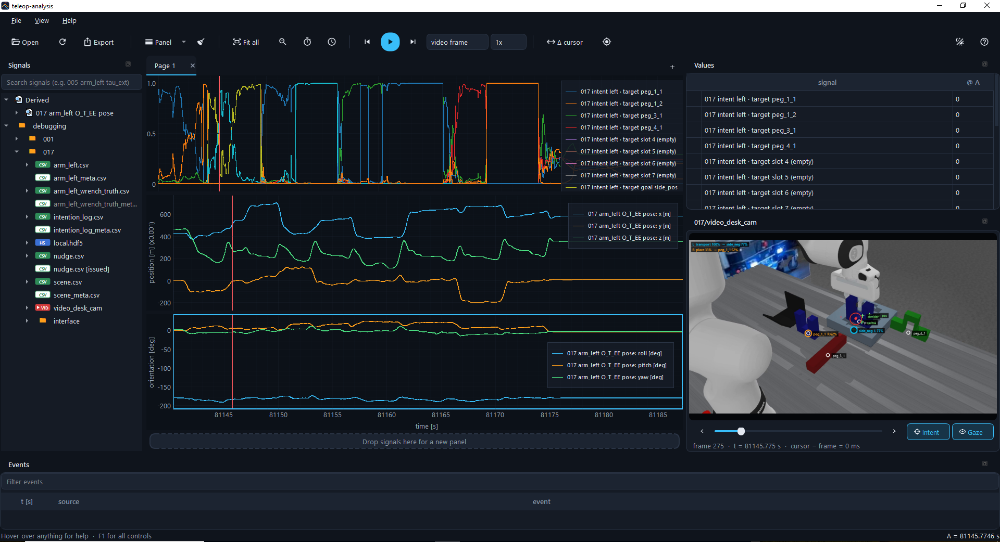

# teleop-analysis

Time-synced viewer for teleop logs: plot signals, video, gaze and intent on one timeline, then export.



## Features

- Open one or more log folders and drag any signal onto linked plot panels; all panels share one time axis.
- Logs from different machines are put on one clock (avatar NUC offset estimated automatically, editable).
- Videos follow the time cursor, with optional gaze and intent overlays.
- Cursors A/B with Δt and Δy, math on signals (SE(3) → pose, derivative, magnitude, expressions, delay estimate).
- Pages and panel layouts, dark and [light](docs/screenshot-light.png) theme, save/load views.
- Export exactly what is on screen: PNG/PDF/SVG, video frame and the visible data as CSV.
- Robust to missing, empty or truncated files; first load is cached as Parquet, so later loads are instant.

## Install

Python 3.10 or newer.

```
git clone https://github.com/AlexanderWegenerRobotics/teleop-analysis.git
cd teleop-analysis
pip install -e .
```

For ROS 2 `.db3` bags use `pip install -e .[ros]`.

## Run

```
teleop-analysis                      # empty window, open or drop folders in it
teleop-analysis D:\data\episode_005  # open folders directly
teleop-analysis --view my_view.json  # restore a saved view
```

On Windows, `teleop-analysis --install-shortcut` adds it to the start menu with its own icon, so it can be found by search and pinned to the taskbar.

## Quick start

1. **File → Open** a log folder. Every file shows up in the tree on the left.
2. Drag a signal onto a plot, or onto the strip at the bottom for a new panel.
3. Click in a plot to set the time cursor. Double-click a video in the tree to open it; it follows the cursor.
4. **Ctrl+E** to export the current view.

| | |
|---|---|
| Wheel / Shift+wheel | zoom time / zoom y |
| Left drag / right drag | pan / zoom into box |
| Double-click, Backspace | fit all, zoom back |
| Click, Shift+click | cursor A, cursor B (Δt) |
| Space, ← → | play, step |
| Right-click a curve | rename, colour, math, move, remove |

Hover over any button for a short help, **F1** shows all controls.

## Default paths

**File → Default paths…** stores your log roots and dataset folder for this machine in `%APPDATA%\teleop-analysis\paths.json` (Linux: `~/.config/teleop-analysis/paths.json`). They are used by **File → Collect episodes…**, which gathers one episode from the avatar, orchestrator and interface logs into a dataset folder.

## Supported data

Avatar CSVs, `*_meta.csv`, video timestamps with `.h264`/`.mp4`, orchestrator `local.hdf5` and `nudge.csv`, interface `command.csv`, `stream.csv`, `events.log`, `frames.jsonl` + `session.mp4`, ROS 2 bags and generic CSVs with a time column. New log types are one small loader class.

## Use from Python

```python
from teleop_analysis import open_folder
cat = open_folder(r"D:\data\DAgger")
df = cat.frame("DAgger/005/arm_left.csv")
```

## More

Full details (clocks, math, overlays, export, collecting episodes, adding loaders) are in [docs/reference.md](docs/reference.md).
